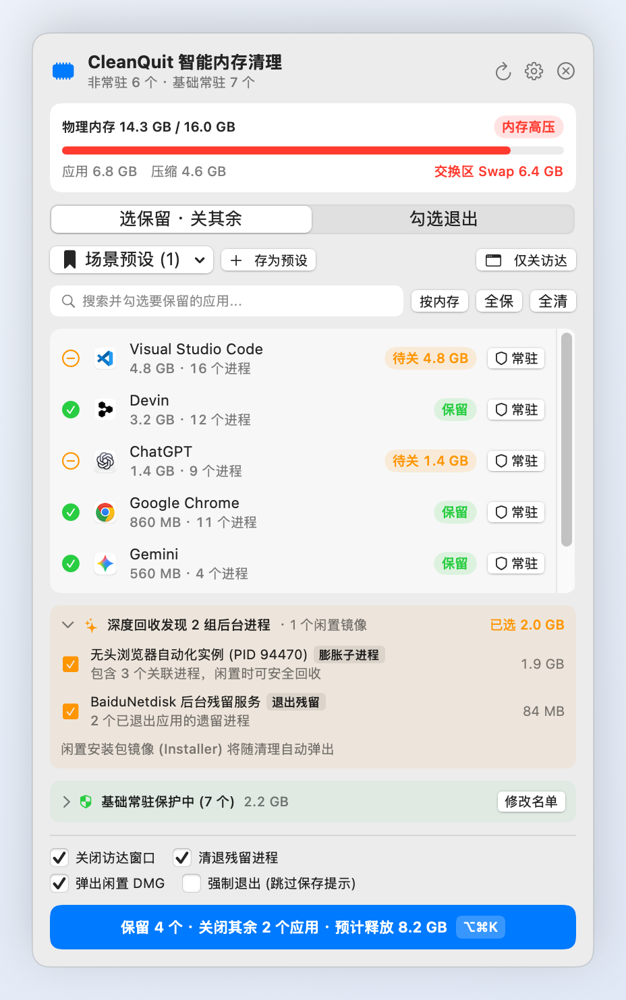
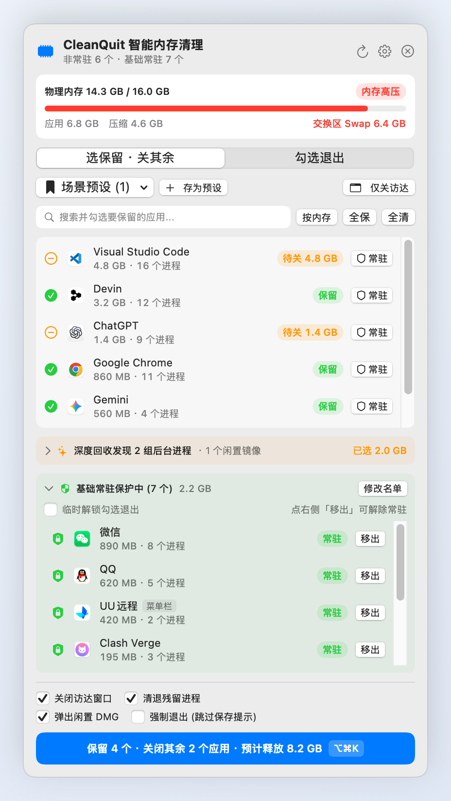
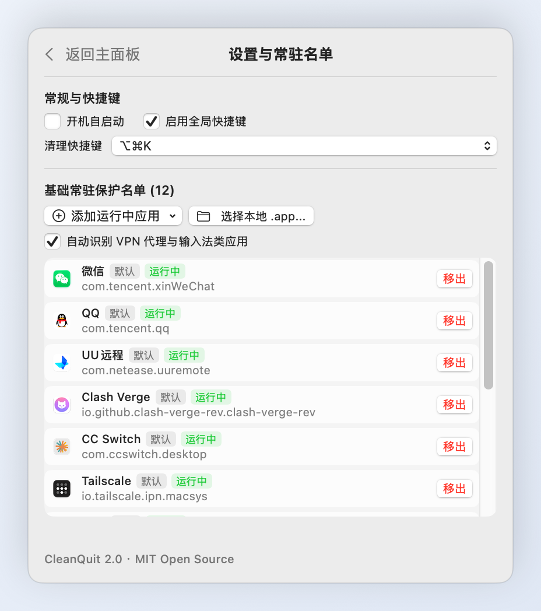

# CleanQuit

CleanQuit 是基于 SwiftUI 与 Darwin 内核接口构建的原生 macOS 菜单栏内存优化与应用清理工具。软件采用选择工作保留项并批量回收其余非常驻进程的交互模型，无需第三方依赖即可在菜单栏实时观测内存压力并释放系统资源。

<p align="center">
  
  
  
</p>

## 界面概览

上排三张原生界面截图分别展示了 CleanQuit 2.0 的三项主要工作视图：

1. **左图（保留模式与深度回收）**。顶部展示物理内存、压缩内存（Compressor）与交换区（Swap）实时占用，中部列出按整棵进程树内存降序排列的非常驻应用，并展开已退出应用残留服务与高内存无头浏览器实例的深度回收列表。
2. **中图（基础常驻保护面板）**。底部折叠区默认锁定保护微信、QQ、Clash Verge、UU远程、Tailscale、CC Switch、Mos 等基础常驻进程，支持单点移出常驻或开启临时解锁开关执行强制退出。
3. **右图（常驻名单编辑与全局设置）**。设置页完整列出本机生效的默认常驻与自定义常驻应用，支持从运行中列表或本地 `.app` 目录增删保护项并配置全局清理快捷键。

## 核心能力

CleanQuit 针对 16 GB 等中小内存 Mac 在多开 IDE、桌面端大模型客户端与电子表格或阅读器时的交换区膨胀问题设计了七项机制：

1. **双清理模式切换**。程序默认运行在「选保留 · 关其余」模式，用户勾选当前任务需要保留的软件后，未勾选的非常驻应用自动进入待清理队列并汇总预计释放容量，同时保留传统的「勾选退出」模式。
2. **基础常驻进程三层保护**。策略引擎内置识别常见 VPN 代理客户端（Clash Verge、Surge、ClashX 等）、内网组网工具（Tailscale、ZeroTier）、即时通讯软件（微信、QQ）、桌面增强工具（CC Switch、UU远程、Mos、BetterDisplay、iBar、ShareMouse）及系统输入法，常规清理与快捷键触发时自动跳过，且允许用户随时增删名单或临时解锁。
3. **整棵进程树真实物理内存核算**。底层服务直接调用 Darwin `proc_listallpids`、`proc_pidinfo` 与 `proc_pid_rusage(RUSAGE_INFO_V4)`，将主进程、子孙进程（Renderer、GPU、Language Server、扩展插件）以及同 `.app` 包路径下脱离父进程的 Helper 聚合并计算真实物理 Footprint。
4. **内核级系统内存与交换区监控**。状态栏面板通过 Mach `host_statistics64` 与 `sysctl vm.swapusage` 实时计算应用内存、联动内存、压缩器占用与磁盘交换区大小，根据阈值划分内存充裕、负载偏高与内存高压三个等级。
5. **深度残留清扫与闲置镜像卸载**。程序在退出目标应用 0.9 秒后会自动复查并终止同包路径下未退出的残留附属进程，同时扫描已退出应用遗留的后台服务、超过 300 MB 的无头浏览器自动化子进程树以及无运行进程占用的 `.dmg` 挂载卷。
6. **一键加速**。内存卡片右上角的「一键加速」先用 2 秒对比两次进程快照，记录每棵进程树消耗的 CPU 时间，再按三类给出方案。第一类是正在使用的应用，包括基础常驻、保留名单、当前前台、最近 10 分钟切到前台、检测期间占用 CPU 以及进程树里运行着包外子任务（终端、智能体、语言服务器）的应用，这一类不做任何操作并在方案底部列出原因。第二类是没有主人的进程，包括父进程已退出且空闲超过 10 分钟的 MCP 或 Playwright 工具服务、已退出应用的残留服务以及控制程序已退出的自动化浏览器，这一类默认勾选。第三类是超过 300 MB 且检测期间无活动的闲置应用，默认不勾选，勾选后按正常方式退出，未保存的文档仍会提示保存。执行前程序会核对每个进程的启动时间以避开被复用的 PID，并跳过检测之后切到前台的应用。
7. **工作流场景预设与无权限全局热键**。内置「论文学习」保留预设，支持将任意保留或退出组合持久化为自定义预设，并通过 Carbon `RegisterEventHotKey` 注册全局快捷键（默认 `⌥⌘K`）与 Apple Events 关闭全部访达窗口。

## 代码结构

仓库采用 Swift Package Manager 标准工程布局，主要模块职责如下：

```text
CleanQuit/
├── Package.swift
├── Resources/
│   └── Info.plist
├── Sources/CleanQuit/
│   ├── CleanQuitApp.swift                 # 菜单栏入口与高压状态图标切换
│   ├── Models/
│   │   ├── AppItem.swift                  # 应用实体与进程树统计指标
│   │   ├── CleanupPreset.swift            # 清理模式枚举与预设编解码模型
│   │   └── EssentialAppPolicy.swift       # 基础常驻应用内置目录与关键词匹配
│   ├── Services/
│   │   ├── AppCleanerService.swift        # 桌面及顶层菜单栏应用扫描与退出收尾
│   │   ├── DiskImageCleanerService.swift  # 闲置 DMG 虚拟磁盘镜像检测与弹出
│   │   ├── FinderService.swift            # Apple Events 批量关闭访达窗口
│   │   ├── GlobalHotkeyService.swift      # Carbon 全局热键注册与回调分发
│   │   ├── ProcessAnalyzerService.swift   # libproc 进程树聚合与残留进程识别
│   │   ├── SpeedUpService.swift           # 一键加速的活动采样、分类规则与安全回收
│   │   └── SystemMemoryService.swift      # Mach VM 与 Swap 负载快照采集
│   ├── ViewModels/
│   │   └── CleanerViewModel.swift         # 双模式状态管理、预设持久化与清理编排
│   └── Views/
│       ├── MenuBarContentView.swift       # 菜单栏主面板、内存卡片与折叠列表
│       ├── PresetSheetView.swift          # 预设命名与保存输入栏
│       └── SettingsView.swift             # 常规开关与基础常驻保护名单管理页
├── Tests/CleanQuitTests/
│   ├── CleanerViewModelTests.swift        # Swift Testing 单元测试套件
│   └── SpeedUpPlannerTests.swift          # 一键加速分类规则测试
└── scripts/
    └── build_app.sh                       # Release 构建、签名与本地安装脚本
```

## 安装与构建

### 环境要求

- macOS 13.0 (Ventura) 或更高版本
- Swift 5.9 或更高版本（从源码构建时需要安装 Xcode 或 Command Line Tools）

### 从 Release 直接安装

前往本仓库的 [Releases](https://github.com/qzkinhit/CleanQuit/releases) 页面下载最新版本的 `CleanQuit-v2.1.0-macos-arm64.zip`，解压后将 `CleanQuit.app` 拖入 `/Applications` 目录并双击启动。

### 从源码编译安装

```bash
git clone https://github.com/qzkinhit/CleanQuit.git
cd CleanQuit
swift test
chmod +x scripts/build_app.sh
./scripts/build_app.sh --install
open /Applications/CleanQuit.app
```

## 权限说明

CleanQuit 读取用户进程内存指标与注册 Carbon 全局快捷键均无需辅助功能或管理员权限。首次勾选执行「关闭访达窗口」时，macOS 会弹出自动化权限请求，在系统设置的隐私与安全性面板中允许 CleanQuit 控制访达（Finder）即可。

## 开源协议

本项目基于 [MIT License](LICENSE) 开源发布。
